# Mercado Express — CP5, Parte 1

Aplicação web para gerenciamento de produtos de um mercado, desenvolvida para o **Checkpoint 5 de Java Advanced da FIAP**. Esta parte reúne o catálogo, o CRUD de produtos, o cadastro de usuários e o controle de acesso com Spring Security. A parte de pedidos pertence a um projeto e repositório separados (**Parte 2**).

- **Aplicação publicada (Render):** [cp5-parte1.onrender.com](https://cp5-parte1.onrender.com/)
- **Vídeo de demonstração das Partes 1 e 2:** [assistir no YouTube](https://youtu.be/vg6UIs_rz0o)
- **Repositório da Parte 2:** [cp5-parte2](https://github.com/EnzoMMaciel10/cp5-parte2)

## Integrantes

- Enzo Monteiro Maciel - RM563734
- Matheus de Almeida Sousa - RM563557
- Paulo Estalise - RM563811
- Gabriel Bebé Silva - RM562012
- Emanuel Italo - RM561337

## Funcionalidades

- Página inicial em `index.html` e interface em português, construída com Thymeleaf e CSS responsivo.
- Cadastro de usuários com validação de nome, e-mail único e senha de pelo menos oito caracteres.
- Tela de login própria, diferente da página padrão do Spring Security, com autenticação por e-mail e senha.
- Dois perfis: `CLIENTE` consulta o catálogo e os detalhes; `ADMIN` também cadastra, edita e exclui produtos.
- Busca de produtos por parte do nome, sem diferenciar maiúsculas de minúsculas.
- CRUD de produtos persistido no PostgreSQL, com validação de preço, custo e estoque.
- Mensagens de confirmação e erro, saída da conta e página personalizada para acesso negado (HTTP 403).

## Tecnologias

Java 17, Spring Boot 4.0.8, Spring MVC, Spring Security, Spring Data JPA, Bean Validation, Thymeleaf, Thymeleaf Extras Spring Security, PostgreSQL, Maven e Lombok. O projeto foi desenvolvido no **IntelliJ IDEA**.

## Como funciona

Ao abrir `/`, o visitante vê a página inicial. Se ainda não possui uma conta, acessa `/cadastro`, informa nome, e-mail e senha e passa a ter o perfil `CLIENTE`. A senha é armazenada com hash BCrypt. Após o cadastro, o usuário é encaminhado à tela de login; um login bem-sucedido abre `/mercado`.

O cliente pode listar, buscar e consultar os detalhes dos produtos. Os links administrativos são exibidos somente para `ADMIN` e as rotas de criação, edição e exclusão também são protegidas no servidor. Portanto, tentar abrir uma rota administrativa diretamente com uma conta `CLIENTE` resulta em acesso negado.

O cadastro público sempre cria usuários `CLIENTE`. O perfil `ADMIN` deve ser atribuído por quem administra o banco de dados a uma conta autorizada; a aplicação não oferece uma rota pública para promover usuários.

### Exemplo de uso

1. Um administrador cadastra **Arroz integral**, tipo **Alimento**, setor **Mercearia**, embalagem **5 kg**, preço **R$ 25,90**, custo **R$ 18,00** e estoque **30**.
2. O produto aparece na lista e pode ser encontrado pesquisando por `arroz`.
3. Qualquer usuário autenticado pode abrir **Detalhes** para consultar as informações do produto.
4. O administrador pode atualizar os dados ou excluir o produto. O cliente não vê esses controles e não tem permissão para acessar as rotas correspondentes.

## Rotas e permissões

| Método | Rota | Função | Acesso |
| --- | --- | --- | --- |
| GET | `/` | Página inicial | Público |
| GET/POST | `/cadastro` | Formulário e criação de conta | Público |
| GET/POST | `/login` | Tela própria e autenticação | Público |
| POST | `/logout` | Encerrar sessão | Autenticado |
| GET | `/mercado` | Listar e buscar produtos | CLIENTE ou ADMIN |
| GET | `/mercado/detalhes/{id}` | Detalhes do produto | CLIENTE ou ADMIN |
| GET | `/mercado/novo` | Formulário de produto | ADMIN |
| POST | `/mercado` | Criar produto | ADMIN |
| GET/POST | `/mercado/editar/{id}` | Formulário e atualização | ADMIN |
| POST | `/mercado/excluir/{id}` | Excluir produto | ADMIN |

## Dados persistidos

O PostgreSQL guarda os produtos na tabela `tds_sec_mvc_tb_mercado` e os usuários na tabela `tds_users_mercado`. O produto possui nome, tipo, setor, tamanho/embalagem, preço de venda, custo de aquisição e quantidade em estoque. O usuário possui nome, e-mail único, senha criptografada e perfil.

As entidades JPA e os repositórios Spring Data fazem a persistência. A configuração local está em `src/main/resources/application.yaml`; o Hibernate está configurado com `ddl-auto: update` para criar ou atualizar as tabelas durante o desenvolvimento.

## Executar localmente

Pré-requisitos: **JDK 17**, **PostgreSQL** em execução na porta `5432` e o banco `cp5` criado. A configuração atual usa o usuário PostgreSQL `postgres` e lê a senha da variável de ambiente `DB_PASSWORD`; ela não deve ser gravada no Git.

No IntelliJ IDEA:

1. Abra a pasta deste projeto como projeto Maven e aguarde a importação das dependências.
2. Configure o SDK do projeto e da execução como **Java 17**.
3. Crie o banco `cp5` no PostgreSQL, se ele ainda não existir.
4. Na configuração de execução de `Cp5Application`, adicione a variável de ambiente `DB_PASSWORD` com a senha do usuário PostgreSQL local.
5. Execute `Cp5Application` e acesse `http://localhost:8080/`.

Também é possível iniciar pela linha de comando, desde que `DB_PASSWORD` já esteja configurada no ambiente:

```powershell
.\mvnw.cmd spring-boot:run
```

Não execute a Parte 1 e a Parte 2 simultaneamente na mesma porta `8080` sem alterar a porta de uma delas.

## Organização do código

```text
src/main/java/br/com/fiap/cp5/
├── config/       # Segurança e codificação de senhas
├── controller/   # Páginas, cadastro, login e CRUD
├── dto/          # Dados recebidos no cadastro
├── model/        # Entidades e perfis
├── repository/   # Acesso ao PostgreSQL
└── service/      # Regras de negócio
src/main/resources/
├── static/       # CSS e imagem de fundo
├── templates/    # Páginas Thymeleaf
└── application.yaml
```

## Verificação funcional

1. Abra a página inicial e a tela personalizada de login.
2. Cadastre uma conta nova; verifique a mensagem de sucesso e entre com essa conta.
3. Como `CLIENTE`, consulte a lista, pesquise um produto e abra os detalhes. Tente acessar `/mercado/novo` diretamente e confirme que o servidor nega o acesso.
4. Entre com uma conta `ADMIN`, cadastre um produto e confira-o na lista e no PostgreSQL.
5. Edite o produto, confira a atualização e depois exclua-o.
6. Saia da conta e confirme que as páginas restritas exigem novo login.

O teste automatizado atualmente incluído no projeto é o teste básico de inicialização do contexto Spring; os passos acima documentam a verificação manual dos fluxos principais.

## Capturas da aplicação

As imagens abaixo mostram a interface da Parte 1 e o fluxo de gerenciamento de produtos. Foram feitas durante a execução local do projeto.

### Configuração inicial do projeto

A captura do Spring Initializr registra a criação do projeto com Maven, Java 17, Spring Boot 4.0.8 e as dependências iniciais de web, templates, persistência, segurança, PostgreSQL e Lombok. As dependências efetivas do projeto estão no `pom.xml`.

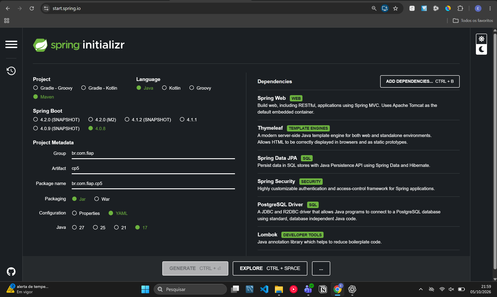

### Página inicial

A página apresenta o catálogo e os caminhos para criar uma conta ou entrar no sistema.

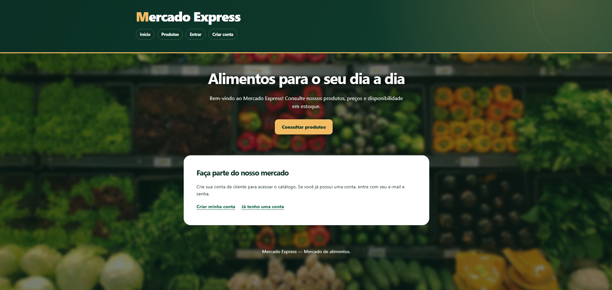

### Cadastro de usuário

O formulário permite criar uma conta com perfil `CLIENTE`, informando nome, e-mail e senha.

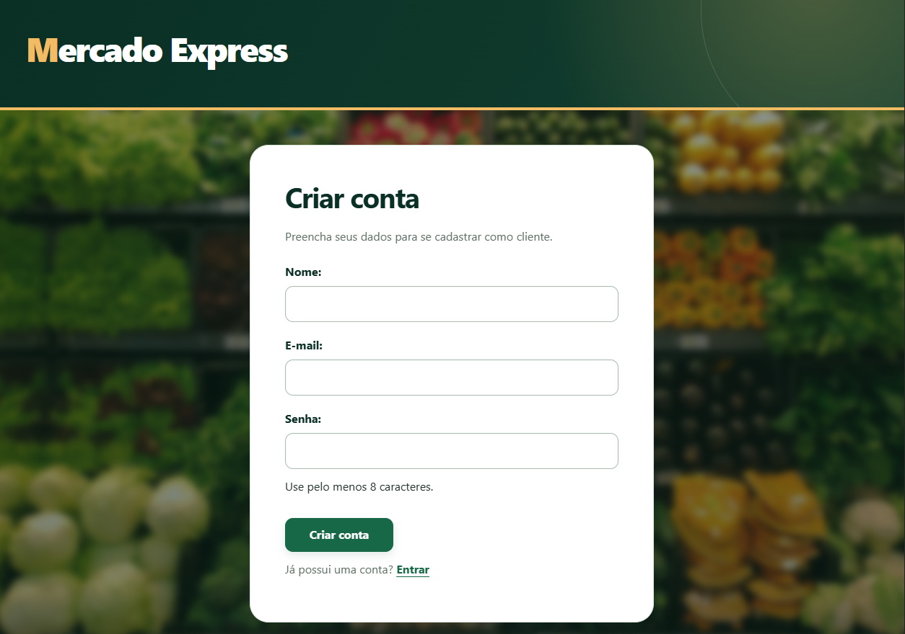

### Login

A tela própria de autenticação recebe o e-mail e a senha cadastrados, com um link para criar uma conta.

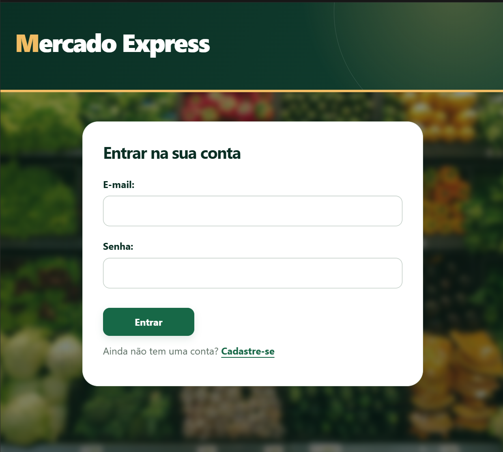

### Catálogo e ações do administrador

Após o login com perfil `ADMIN`, a lista mostra a busca, os produtos e as ações de cadastrar, consultar detalhes, editar e excluir.

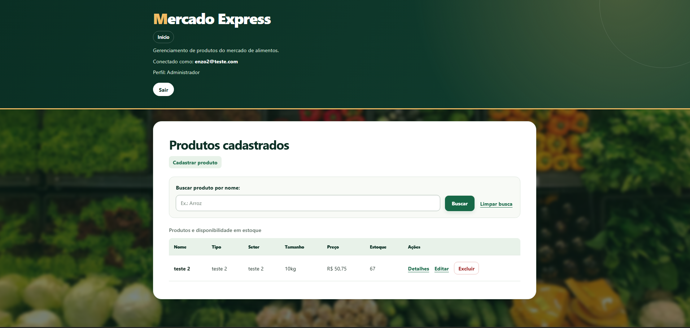

Esta visão mais próxima mostra a pesquisa por nome, os dados em estoque e as ações disponíveis para cada produto.

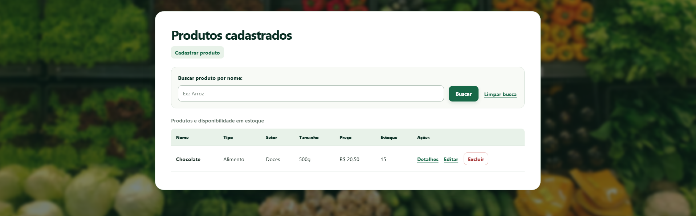

### Visão do cliente e controle de acesso

O perfil `CLIENTE` consegue consultar o catálogo e abrir os detalhes, mas não vê os controles de cadastro, edição ou exclusão.

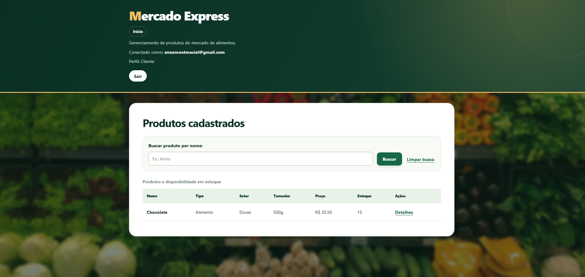

A página de detalhes apresenta os dados do produto e sua disponibilidade em estoque.

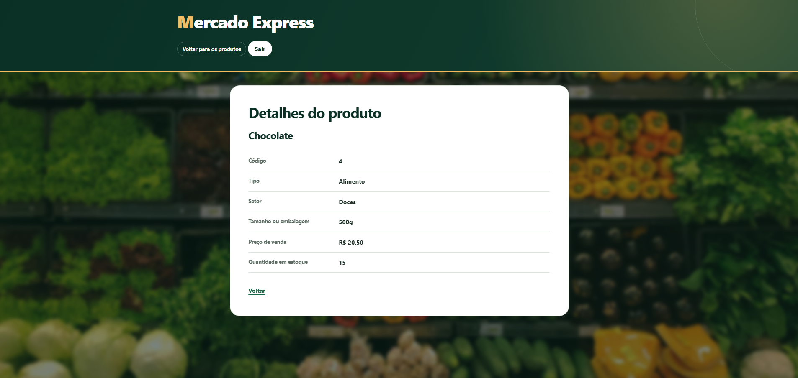

Ao tentar abrir diretamente `/mercado/novo`, o cliente recebe a página personalizada de acesso negado. O bloqueio é aplicado no servidor, além da ocultação dos controles na interface.

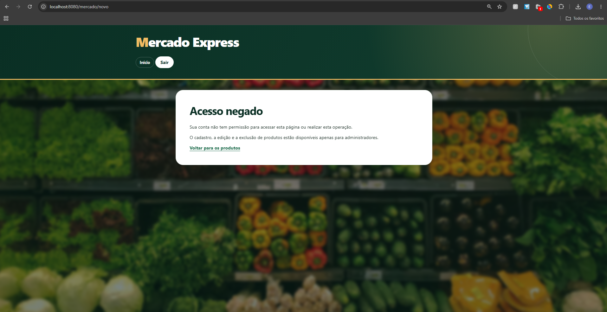

### Cadastro de produto

O formulário reúne os dados, o preço, o custo e a quantidade em estoque. A confirmação de cadastro aparece na lista após salvar um novo produto.

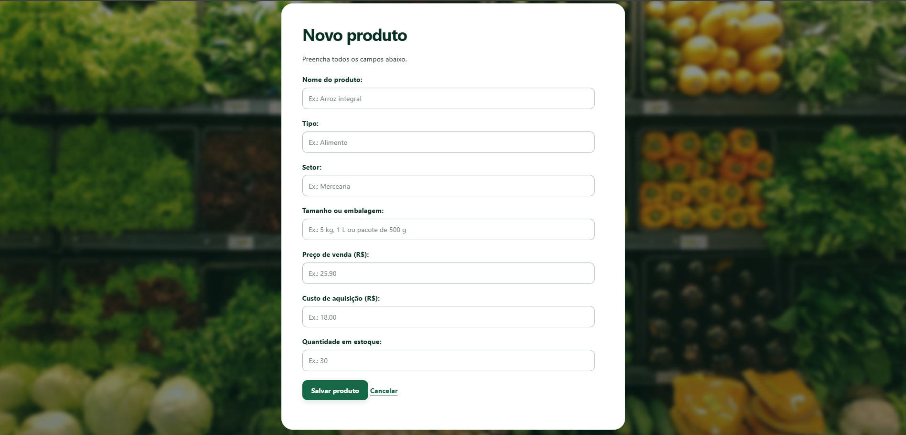

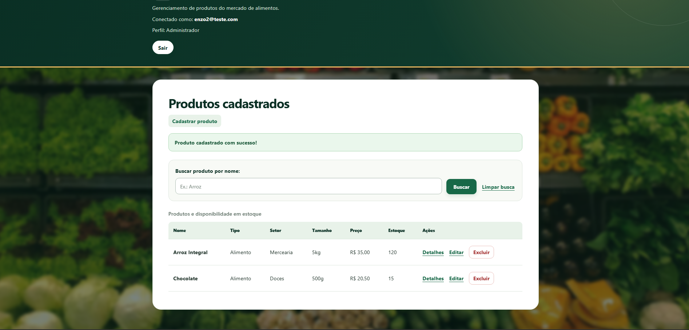

### Edição de produto

O administrador pode alterar os dados de um produto existente. Depois de salvar, a lista exibe os dados atualizados e uma mensagem de sucesso.

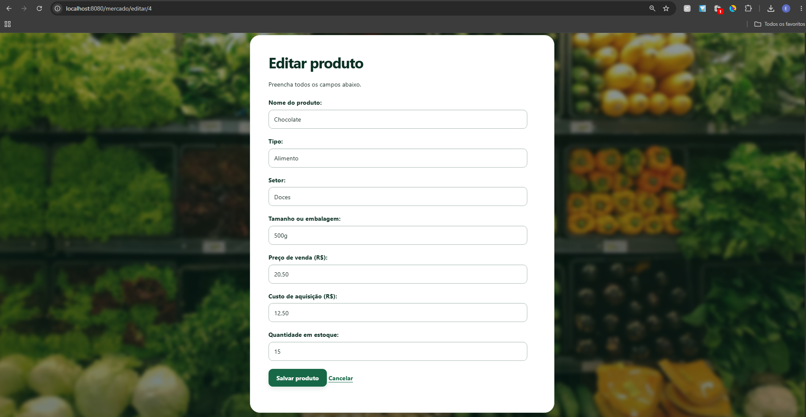

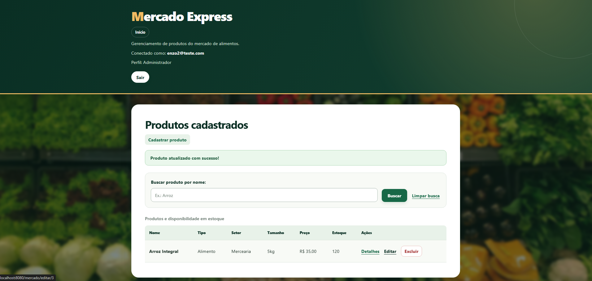

### Exclusão de produto

Depois da exclusão, o produto deixa a lista e a aplicação confirma a operação.

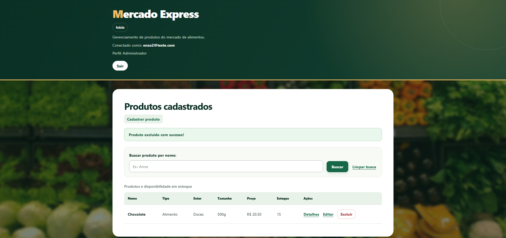

## Publicação

**Aplicação publicada:** [https://cp5-parte1.onrender.com/](https://cp5-parte1.onrender.com/). O `Dockerfile` compila a aplicação com Java 17 e inicia o arquivo JAR. A aplicação usa a porta indicada por `PORT` na hospedagem e continua usando `8080` quando executada localmente.

### Deploy gratuito no Render

1. Crie uma conta no Render e, no painel, crie um banco **Render Postgres** com o plano **Free**. Anote na página **Info** o host interno, o nome do banco, o usuário e a senha. Guarde a senha apenas nas configurações privadas do Render.
2. Crie um **Web Service** a partir deste repositório, na branch `main`, com runtime **Docker** e plano **Free**. Escolha a mesma região do banco para permitir a conexão interna.
3. Em **Environment**, configure as variáveis abaixo, usando os dados do banco criado:

   | Variável | Valor |
   | --- | --- |
   | `DB_URL` | `jdbc:postgresql://HOST_INTERNO:5432/NOME_DO_BANCO` |
   | `DB_USER` | Usuário do PostgreSQL mostrado pelo Render |
   | `DB_PASSWORD` | Senha do PostgreSQL mostrada pelo Render |

4. Faça o deploy e abra o endereço `https://...onrender.com/` informado pelo Render. Cadastre um usuário novo e teste o login e o catálogo. Para testar o perfil `ADMIN`, atribua esse perfil a uma conta autorizada no banco de dados, conforme descrito acima.
5. Os dados do PostgreSQL local **não são transferidos automaticamente** para o banco hospedado.

No plano gratuito, o serviço web pode adormecer após ficar sem uso, e o banco Render Postgres gratuito expira depois de 30 dias. Se o projeto precisar ficar disponível por mais tempo, será necessário migrar o banco ou mudar de plano.
